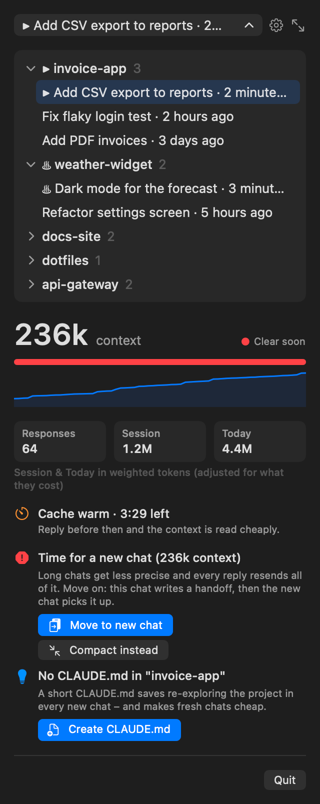
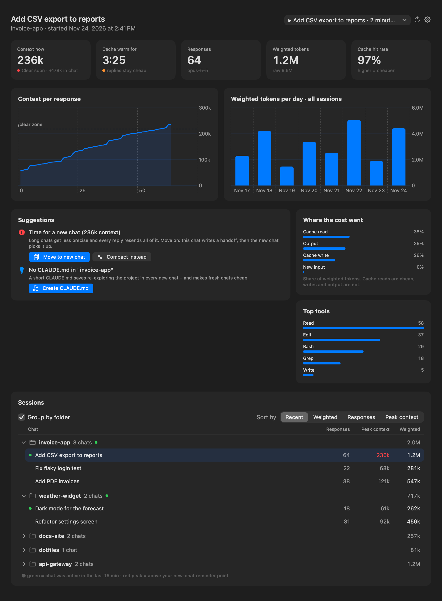
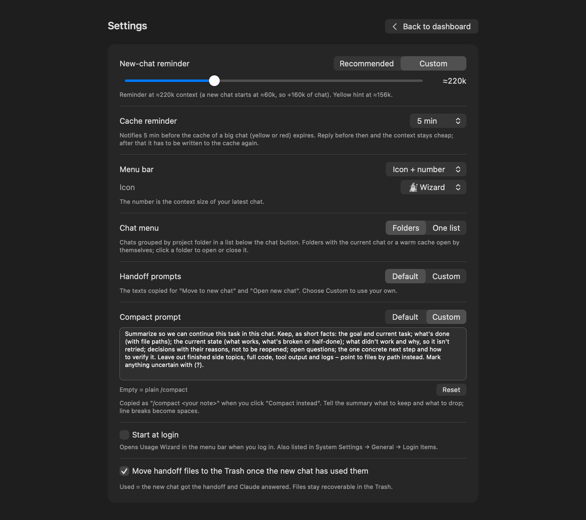

# usage-wizard – Claude Code usage tools (macOS)


Small local tools that show how you use Claude Code, based on the session logs in
`~/.claude/projects` on your own Mac.

> **Unofficial project.** Not affiliated with, endorsed by, or sponsored by Anthropic.
> "Claude" and "Claude Code" are trademarks of Anthropic.

<p align="center">
  
  &nbsp;
  
</p>
<p align="center"><sub>Menu bar panel and dashboard (example data)</sub></p>

## Why

Every reply in Claude Code re-reads the whole chat. A chat at 200k context costs
several times more per reply than a fresh one, and an expired cache makes the next
reply write all of it again. That is what eats your usage limit.

Usage Wizard makes this visible and helps you act at the right moment:

- See how big your current chat is, right in the menu bar.
- Get a reminder when a chat gets too big, and move to a fresh chat in two clicks,
  without losing what was decided (a handoff note carries it over).
- Get a reminder before the cache of a big chat expires, so you can reply in time.
- Find out where your tokens went: per chat, per day, per cost type and tool.

## Features

### Menu bar

- **Live context size** of your latest chat next to the icon (icon and number can be
  changed in Settings). Latest = where you or Claude wrote last; just clicking a chat in
  Claude doesn't switch it.
- Click it for the **panel**:
  - **Chat menu** at the top, **gear** for Settings, and the **expand** button for the
    dashboard window. **▶** marks the chat shown now (and its folder); **♨** in front of
    another chat (or a folder) means its cache is still warm (5 minutes or 1 hour after the last
    reply), so continuing it is cheap. The cache timer below counts it down for the
    selected chat.
  - **Status at a glance:** Healthy, Getting big or Clear soon (green, orange, red),
    with a small chart of the chat's context.
  - **Cache timer:** "Cache warm · 3:12 left" shows how long replies stay cheap.
    Once the cache has expired, it tells you how much the next reply has to rewrite.
  - **Usage** of the chat and of today in weighted tokens (each token counted by
    what it costs: output, cache writes and cache reads are weighted differently).
  - **Suggestions** with one-click actions.

### New-chat reminder and handoff

1. When a chat grows past your reminder point, you get a notification
   **"Time for a new chat"** (again at 2×, 3× …).
2. **Move to new chat** (in the notification or the panel) copies a prompt to the
   clipboard and brings Claude to the front. Paste it into the chat (⌘V, Enter), and
   Claude writes a handoff note into `.handoffs/` in your project: goal, what's done,
   what didn't work, decisions, next step, how to verify.
3. As soon as the note exists, you get **"Handoff ready"**. **Open new chat** starts a
   new Claude Code chat in the same folder with the prompt already typed: read the
   note, check it, then sum up the state and ask before it starts. Press Enter, then
   answer with the go-ahead or anything you want to add or change first.

New chats are numbered: "Fix login" continues as "#1 Fix login", then "#2 Fix login".
Each chat gets its own note, so several chats in one project don't overwrite each other.
Used notes go to the Trash automatically (on by default, recoverable).

Other actions in the suggestions: **Compact instead** (copies `/compact` with a note on what
the summary must keep: goal, decisions, what didn't work, next steps, file paths – to stay
in the chat; your own note in Settings) and **Create CLAUDE.md** (opens a chat that writes a short `CLAUDE.md`, so every
new chat starts faster).

Nothing is typed or pasted for you: Usage Wizard only uses the clipboard and the Claude
app's "new chat" link, so it needs no Accessibility permission.

### Cache reminder

Claude Code caches your chat's context, so replies only read it cheaply. After a pause
(usually 1 hour, sometimes 5 minutes) the cache expires and the next reply has to write
the whole context again. For big chats (orange or red) without a handoff, Usage Wizard
notifies you a few minutes before that happens (default 5): reply in time, or click
**Move to new chat**.

### Settings

<p align="center"></p>

Click the **gear** in the menu bar panel (settings show inside the panel) or in the top
right corner of the dashboard window (opens a settings page; **Back to dashboard** or Esc
returns).

- **New-chat reminder:** *Recommended* (≈160k total context, i.e. +100k on top of a
  fresh chat's ≈60k) or *Custom* with a slider from +40k to +440k (≈100k to ≈500k total).
- **Cache reminder:** how many minutes before the cache expires (default 5). Pick a
  value from the dropdown, or choose *Custom* and type your own (1–55 min), or turn it off.
- **Menu bar:** icon + number, icon only (hides the number, e.g. when sharing your
  screen) or number only, and which icon: the pixel wizard (default), a wizard hat
  or a magic wand with a star.
- **Chat menu:** *Folders* (default) or *One list* (all chats, newest first). *Folders*: a list opens
  below the chat button with chats grouped by project folder. Folders holding the current
  chat or a warm cache open by themselves; click any folder to open or close it. Long chat titles are shortened.
- **Handoff prompts:** *Default* or *Custom*: edit the text copied for **Move to new chat**
  (old chat) and the one sent by **Open new chat** (new chat). `{file}` stands for the
  handoff path; if you leave it out, the path is added at the end. **Reset** brings
  back the default text.
- **Compact prompt:** *Default* or *Custom*: edit the note copied after `/compact` by
  **Compact instead** (what the summary keeps and drops). Line breaks become spaces; an
  empty note copies plain `/compact`. **Reset** brings back the default note.
- **Start at login:** opens Usage Wizard when you log in to your Mac (off by default).
  It is listed under System Settings → General → Login Items and can be turned off there too.
- **Trash used handoff notes:** on or off.

### Dashboard window

- **Context per response** chart for the selected chat, with your reminder point.
- **Weighted tokens per day** across all sessions.
- **Where the cost went** (input, output, cache writes, cache reads) and **top tools**.
- **Sessions list**, grouped by project folder (collapsible; "Group by folder" switches back to one list), sortable by recent, weighted usage, responses or peak context.
  A green dot marks chats active in the last 15 minutes, a red peak means the chat went
  above your new-chat reminder point. Rest the mouse on a column title or sort option
  to see what it means.
- **Suggestions**, e.g. Opus used for small steps, frequent cache expiry, many
  screenshots, or a project without a `CLAUDE.md`.

There is also a one-page HTML report (see [HTML report](#html-report)).

## Install

Requirements: Apple silicon Mac, macOS 14 or later, Claude Code (desktop app for the
"Open new chat" button).

```bash
xcode-select --install          # Command Line Tools (skip if already installed)
git clone https://github.com/ambilux/usage-wizard.git
cd usage-wizard/menubar && zsh build.sh
```

`build.sh` builds the app without Xcode, signs it ad-hoc (no certificate needed),
installs it to `/Applications` and launches it. The app needs no special permissions;
allow notifications when macOS asks, otherwise the reminders can't appear.
To check that notifications work, quit the app and start it once with
`"/Applications/Usage Wizard.app/Contents/MacOS/UsageWizard" --test-notification &`.

No git? Click **Code → Download ZIP** on this page, unzip it, then run
`zsh build.sh` inside the `menubar` folder.

To start it automatically when you log in, turn on **Start at login** in Settings
(it then appears in **System Settings → General → Login Items**).

Update later (inside the `usage-wizard` folder):

```bash
git pull && zsh menubar/build.sh
```

### Uninstall

1. In Settings, turn off **Start at login**, then click **Quit** in the panel.
2. Delete the app:

   ```bash
   rm -rf "/Applications/Usage Wizard.app"
   ```

3. Optional: remove its settings with `defaults delete local.usagewizard`, and any
   leftover handoff notes in the `.handoffs/` folders of your projects.

Your Claude Code logs in `~/.claude/projects` are never changed, so there is nothing
to clean up there.

## Privacy

- Everything runs locally: no network access, no third-party packages, no telemetry.
- Only reads `~/.claude/projects`. In your project folders it only checks whether a
  handoff note or a `CLAUDE.md` exists. Your data never leaves your Mac.
- Keeps only token counts, sizes and times in memory, not your chat contents (the one
  exception: your prompts that mention a handoff note, to see when a note was used).
- It writes no files itself: handoff notes in `.handoffs/` of your project are written by
  Claude when you ask, and Usage Wizard only moves used ones to the Trash (can be turned
  off in Settings). Add `.handoffs/` to your `.gitignore` if you don't want them committed.
- The generated `dashboard.html` contains your own usage data and project names –
  don't commit or share it (it is listed in `.gitignore`).

## HTML report

```bash
python3 build.py      # writes dashboard.html next to the script
open dashboard.html
```

Requires Python 3 (preinstalled on macOS or via the Command Line Tools).

## App icon

The pixel wizard (app icon, menu bar icons and the banner above) is original artwork for
this project, created with Claude, Anthropic's AI assistant. It is drawn from code in
`menubar/icon/make_wizard.swift` during the build, so there are no image files in the
repository. The one exception is the README banner, `docs/banner.svg`, generated by the
same script (`swift menubar/icon/make_wizard.swift --banner docs/banner.svg`).
Like the rest of the project, it is under the MIT license.

## License

[MIT](LICENSE)
